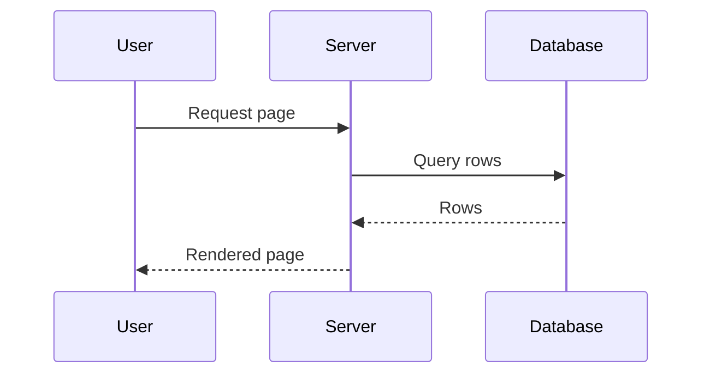

# Indent comparison

Each block below is drawn the way a chat message draws it, so you can judge the left indent against this prose and the code block at the end.

```svg
<svg viewBox="0 0 400 220">
  <title>Binary search tree</title>
  <g stroke="#cdd6f4" stroke-width="2" fill="none">
    <line x1="200" y1="30" x2="110" y2="90"/>
    <line x1="200" y1="30" x2="290" y2="90"/>
    <line x1="110" y1="90" x2="65" y2="155"/>
    <line x1="110" y1="90" x2="155" y2="155"/>
    <line x1="290" y1="90" x2="245" y2="155"/>
    <line x1="290" y1="90" x2="335" y2="155"/>
  </g>
  <g stroke="#cdd6f4" stroke-width="2" fill="#313244">
    <circle cx="200" cy="30" r="20"/>
    <circle cx="110" cy="90" r="20"/>
    <circle cx="290" cy="90" r="20"/>
    <circle cx="65" cy="155" r="20"/>
    <circle cx="155" cy="155" r="20"/>
    <circle cx="245" cy="155" r="20"/>
    <circle cx="335" cy="155" r="20"/>
  </g>
  <g fill="#cdd6f4" font-family="sans-serif" font-size="18" text-anchor="middle">
    <text x="200" y="36">4</text>
    <text x="110" y="96">2</text>
    <text x="290" y="96">6</text>
    <text x="65" y="161">1</text>
    <text x="155" y="161">3</text>
    <text x="245" y="161">5</text>
    <text x="335" y="161">7</text>
  </g>
</svg>
```

A wide flowchart is the case where a narrow terminal drops the indent, because the figure would otherwise shrink.


A tall sequence diagram follows.



The quadratic formula, as display math:

$$
x = \frac{-b \pm \sqrt{b^2 - 4ac}}{2a}
$$

An aligned block:

\[
\begin{aligned}
(a+b)^2 &= a^2 + 2ab + b^2 \\
(a-b)^2 &= a^2 - 2ab + b^2 \\
(a+b)(a-b) &= a^2 - b^2
\end{aligned}
\]

And a code block, for comparison:

```python
def square(n):
    total = n * n
    return total
```
